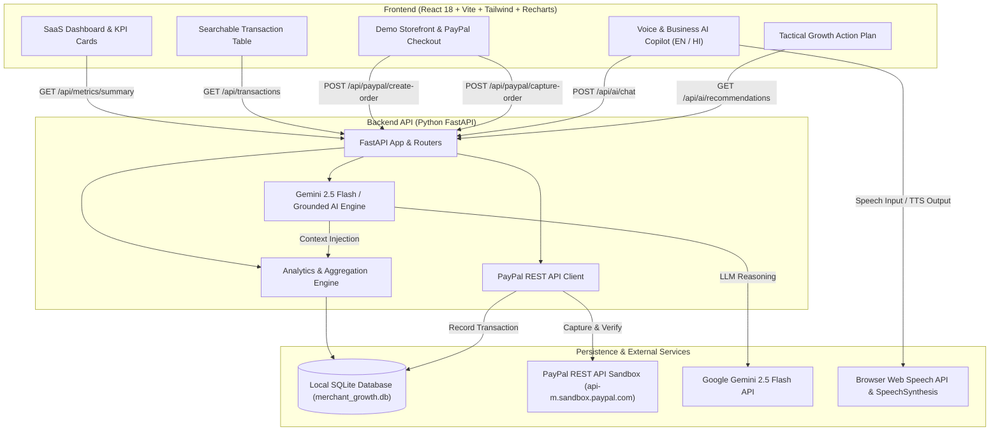

# Merchant Growth AI — Intelligent Business Agent
### Built for the PayPal AI Hackathon 2026

[](https://fastapi.tiangolo.com)
[](https://reactjs.org)
[](https://developer.paypal.com)
[](https://aistudio.google.com)
[](https://developer.mozilla.org/en-US/docs/Web/API/Web_Speech_API)
[](https://sqlite.org)
[](https://tailwindcss.com)
[](https://opensource.org/licenses/MIT)

---

## 💡 Executive Summary & Product Goal

Small e-commerce merchants often struggle to understand **why sales fluctuate**, **which products drive real margins**, and **how to reduce cart abandonment**. 

**Merchant Growth AI** is an intelligent business copilot designed for small merchants. It combines:
1. **Server-side PayPal Sandbox checkout & capture** to reliably record payment volumes, platform fees, and net margins.
2. **Real-time SQLite payment ledger analytics** to calculate gross revenue, captured volume, AOV, and refund rates.
3. **A grounded AI Business Agent (powered by Google Gemini 2.5 Flash with deterministic fallback)** that inspects live database records to answer business questions with cited factual numbers, explains mid-week dips, and proposes practical growth actions.
4. **Bilingual Voice Assistant (English & Hindi)**: Full speech-to-text input with live transcript editing, SpeechSynthesis audio responses, replay controls, mute/unmute, and state management (`idle`, `listening`, `processing`, `speaking`, `error`).

---

## 🏗️ Architecture Overview



---

## ✨ Core Features

| Feature | Description |
| :--- | :--- |
| **Responsive SaaS Dashboard** | Clean sidebar navigation, high-contrast typography, and accessible UI inspired by PayPal design language. |
| **4 Prominent KPI Cards** | Total Revenue, Successful Payments, Total Orders, and Average Order Value with period-over-period percentage growth. |
| **Interactive Recharts Trends** | Curvy Area and Bar charts displaying daily revenue, captured volume, and refund trajectories over 7, 30, 60, or 90 days. |
| **Peak Ordering Traffic** | Hourly distribution heatmap (9:00 AM – 11:00 AM peak identification) for scheduling flash promotions. |
| **Searchable Transaction Ledger** | Filter by status (`COMPLETED`, `PENDING`, `REFUNDED`), search by customer name, email, or order ID, with full pagination. |
| **Transaction Detail & Refund Modal** | Deep view of line items, PayPal Order & Capture IDs, net payout breakdown, and server-side refund execution. |
| **Bilingual Voice Assistant (EN / HI)** | Speak in English or Hindi using the Web Speech API. Real-time transcript appears in the input field for editing before submitting. |
| **SpeechSynthesis Audio Output** | Listens to answers read aloud with language-matching voices, replay controls, mute/unmute, and stop audio. |
| **Grounded AI Business Agent** | Answers questions like *"Why did sales decrease?"* and *"What is my total revenue?"* using actual database records and metric citations. |
| **Tactical Growth Recommendations** | Prioritized actions (Basket Size, Pay in 4 Messaging, Restock Scheduling) with confidence scores, impact estimates, and metric evidence. |
| **PayPal Sandbox Checkout** | Complete server-side order creation (`intent: CAPTURE`) and payment verification. Captures are written directly to SQLite and update the dashboard. |
| **High-Fidelity Demo Mode** | Pre-seeded with 65+ realistic specialty coffee merchant transactions. Includes a 1-click **Reset Demo Data** button. |

---

## 🔒 Security & Payment Integrity

- **Zero-Trust Client Design**: The frontend never holds the PayPal Secret or AI API Keys.
- **Server-Side Verification**: Client payment status is never trusted. The backend connects directly to `api-m.sandbox.paypal.com/v2/checkout/orders/{id}/capture` to verify payment completion and calculate actual fees before committing to SQLite.
- **Safe Fallback**: If no live PayPal credentials are provided in `.env`, the application gracefully runs in **Sandbox Simulator mode**, allowing hackathon judges to test complete checkout, capture, and database updates without friction.
- **Input Validation**: All endpoints use Pydantic models with schema validation, preventing injection and malformed requests.

---

## ⚙️ Environment Variables

| Variable | Required | Default | Description |
| :--- | :---: | :---: | :--- |
| `ENVIRONMENT` | No | `development` | Application mode (`development` or `production`). |
| `DEMO_MODE` | No | `true` | Enables sample data auto-seeding. |
| `DATABASE_URL` | No | `sqlite:///./merchant_growth.db` | SQLAlchemy database URL (supports Render persistent disks e.g. `sqlite:////var/data/merchant_growth.db`). |
| `PORT` | No | `8000` | Port for the backend API server. |
| `HOST` | No | `0.0.0.0` | Host interface binding. |
| `CORS_ORIGINS` | No | `*` | Comma-separated list of allowed origins. |
| `PAYPAL_MODE` | No | `sandbox` | `sandbox` or `live`. Keep `sandbox` for testing. |
| `PAYPAL_CLIENT_ID` | Optional | `""` | PayPal Developer Sandbox App Client ID. |
| `PAYPAL_CLIENT_SECRET` | Optional | `""` | PayPal Developer Sandbox App Secret. |
| `GEMINI_API_KEY` | Optional | `""` | Google AI Studio Gemini API Key. |
| `GEMINI_MODEL` | No | `gemini-2.5-flash` | Gemini model variant. |
| `VITE_API_BASE_URL` | Optional | `""` | Optional base URL for decoupled frontend hosting (e.g. `https://api.merchant-growth.onrender.com`). |

---

## 🚀 Local Quickstart Guide

### Prerequisites
- **Python 3.10+**
- **Node.js 18+ & npm**

### 1-Click Launch (Windows)
Double-click `start_servers.bat` in the project root to automatically launch both the FastAPI backend (`http://localhost:8000`) and Vite frontend (`http://localhost:5173`).

### Manual Launch

#### Step 1: Backend Setup
```bash
# Navigate to backend
cd backend

# (Optional) Create virtual environment
python -m venv venv
# On Windows:
.\venv\Scripts\Activate.ps1
# On macOS/Linux:
source venv/bin/activate

# Install dependencies
pip install -r requirements.txt

# Run automated tests (11 passing tests)
python -m pytest tests/test_services_and_endpoints.py -v

# Start FastAPI server
python -m uvicorn app.main:app --host 0.0.0.0 --port 8000 --reload
```
API docs: `http://localhost:8000/docs` | Health check: `http://localhost:8000/api/health`

#### Step 2: Frontend Setup
```bash
# In a new terminal, navigate to frontend
cd frontend

# Install dependencies
npm install

# Build production bundle
npm run build

# Start development server
npm run dev
```
Open `http://localhost:5173` in your browser.

---

## ☁️ Render Deployment Guide

### Option 1: 1-Click Blueprint (`render.yaml`) — Recommended
1. Push this repository to your GitHub account.
2. Log in to [Render Dashboard](https://dashboard.render.com).
3. Click **New +** > **Blueprint**.
4. Connect your GitHub repository. Render reads `render.yaml` and configures the unified Web Service automatically.
5. In the environment variables prompt, optionally paste your `PAYPAL_CLIENT_ID`, `PAYPAL_CLIENT_SECRET`, and `GEMINI_API_KEY`.
6. Click **Apply**. Render builds the React frontend, installs Python requirements, and launches the app!

### Option 2: Manual Web Service Setup (Single Unified Service)
1. In Render, select **New +** > **Web Service**.
2. Connect your repository.
3. Configure:
   - **Name**: `merchant-growth-ai`
   - **Environment**: `Python 3`
   - **Region**: Any (e.g., Oregon or Frankfurt)
   - **Branch**: `main`
   - **Build Command**:
     ```bash
     npm --prefix frontend install && npm --prefix frontend run build && pip install -r requirements.txt
     ```
   - **Start Command**:
     ```bash
     python -m uvicorn app.main:app --host 0.0.0.0 --port $PORT --app-dir backend
     ```
   - **Health Check Path**: `/api/health`
4. Under **Environment Variables**, add:
   - `ENVIRONMENT`: `production`
   - `DEMO_MODE`: `true`
   - `DATABASE_URL`: `sqlite:///./merchant_growth.db`
   - `PAYPAL_MODE`: `sandbox`
   - `PAYPAL_CLIENT_ID`: *(Your PayPal Sandbox Client ID)*
   - `PAYPAL_CLIENT_SECRET`: *(Your PayPal Sandbox Secret)*
   - `GEMINI_API_KEY`: *(Your Google AI Studio Gemini API Key)*
   - `GEMINI_MODEL`: `gemini-2.5-flash`
5. Click **Deploy Web Service**.

---

## 🧪 Testing the Complete PayPal Checkout & Capture Flow

1. Click on **"Demo Checkout"** in the header.
2. Select items from the catalog (e.g. *Ethiopia Yirgacheffe Single Origin* or *Handmade Ceramic Mug*).
3. Click the **"PayPal Sandbox Checkout"** button.
4. The backend executes server-side order creation (`POST /v2/checkout/orders`) and verifies capture (`POST /v2/checkout/orders/{id}/capture`).
5. Upon capture, transaction details, PayPal capture ID, fee deductions, and net payouts are written to the SQLite ledger.
6. Return to **Dashboard** or **Transactions** to see metrics and charts updated in real time.
7. Click any transaction in the ledger to view line items or issue a verified refund.

---

## 🎙️ Testing the Voice Assistant

1. Click **"Voice Assistant"** in the top header or click the **AI Assistant** sidebar tab.
2. Choose your language: **English** or **हिंदी (Hindi)**.
3. Click the microphone button and speak your business question:
   - *"What is my total revenue?"* / *"मेरा कुल रेवेन्यू कितना है?"*
   - *"Why did my sales decrease?"* / *"बिक्री क्यों कम हुई?"*
   - *"Which days had the highest sales?"* / *"सबसे ज्यादा बिक्री किस दिन हुई?"*
   - *"What are my top-performing products?"*
   - *"How can I increase repeat purchases?"*
4. Your speech is transcribed in real-time in the input box, allowing you to edit before sending.
5. The assistant returns a grounded response with cited database figures and reads the answer aloud.
6. Use **Replay Audio**, **Stop Audio**, **Mute**, or **Clear Chat** at any time.

---

## 🏆 Hackathon Evaluation Checklist

| Hackathon Requirement | Implementation Detail | Status |
| :--- | :--- | :---: |
| **PayPal REST API Sandbox Integration** | Server-side order creation (`/v2/checkout/orders`) and capture (`/v2/checkout/orders/{id}/capture`) with seller fee calculation. | ✅ Tested |
| **Voice Business Assistant** | Web Speech API speech-to-text, SpeechSynthesis audio output, live transcription editing, English & Hindi support. | ✅ Tested |
| **Intelligent Business Assistant** | Grounded in live SQLite data with metric citations and tactical action recommendations. Configurable Gemini 2.5 Flash. | ✅ Tested |
| **SaaS Merchant Dashboard** | 4 prominent KPI cards, Recharts daily trends, Category share, and Hourly traffic analysis. | ✅ Tested |
| **Searchable Ledger & Detail Modal** | Filterable by status with full pagination, line-item inspector, and refund handler. | ✅ Tested |
| **Security & Best Practices** | Zero credentials in client-side code; verified server-side captures; zero-loss data reset controls. | ✅ Tested |
| **Automated Test Suite** | 11 automated unit & integration tests covering health, metrics, transactions, refunds, PayPal lifecycle, and AI grounding. | ✅ Passed |

---

## 📄 License
This project is licensed under the MIT License for the PayPal AI Hackathon 2026.
